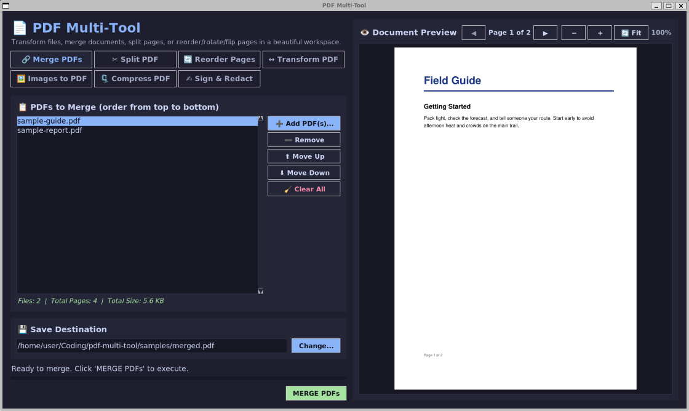
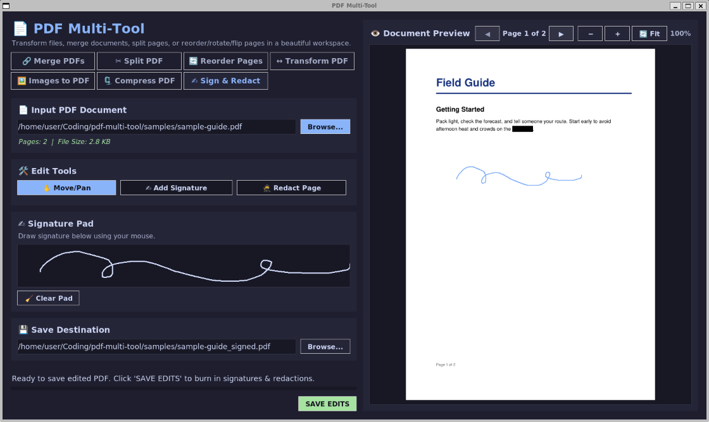

# PDF Multi-Tool

[](https://www.python.org/downloads/)
[](https://docs.python.org/3/library/tkinter.html)
[](LICENSE)
[](Dockerfile)

> **A single-file desktop toolbox for everyday PDF jobs.** Merge, split, reorder, transform, compress, sign and redact PDFs, or turn images into one, with a live page preview. Everything runs locally and no file leaves your machine.

<p align="center">
  <a href="docs/images/Merge.png"></a>
  <br>
  <sub>Merge tab with the sample PDFs from <code>docs/samples</code>.</sub>
</p>

---

## Features

- **Merge PDFs**: combine several documents in the order you set.
- **Split PDF**: extract every page, custom ranges (`1-3, 5, 8-12`), or fixed-size parts.
- **Reorder Pages**: move pages up or down, rotate or flip individual pages, delete pages.
- **Transform PDF**: rotate the whole document and mirror it horizontally or vertically.
- **Images to PDF**: build a PDF from a set of images.
- **Compress PDF**: three levels, from lossless cleanup to heavy image downscaling (72 DPI).
- **Sign & Redact**: draw a signature and place it, or black out sensitive areas.
- **Live preview**: page navigation and zoom for the loaded document.

Built on [pypdf](https://pypi.org/project/pypdf/) and [PyMuPDF](https://pymupdf.readthedocs.io/). The whole app is one file, [`pdf_multi_tool.py`](pdf_multi_tool.py).

---

## Screenshots

*Click an image to see it full size.*

<p align="center">
  <b>Sign &amp; Redact</b>: draw a signature, place it on the page, and black out sensitive text.<br>
  <a href="docs/images/SignRedact.png"></a>
</p>

---

## Quickstart

### Option A: Run locally

Requires Python 3.12+ with Tk.

```bash
pip install pypdf pymupdf
python pdf_multi_tool.py
```

On Linux you may need `sudo apt install python3-tk`.

### Option B: Docker Compose (Linux / WSL2)

```bash
docker compose run --rm pdf-multi-tool
```

Add `--build` after changing the code.

The container's home folder, `/home/user`, is where the file dialogs start. It is your own home folder (`$HOME`, or `%USERPROFILE%` on Windows), so no setup is needed. To use a different folder, set `HOME_DIR`:

```bash
HOME_DIR=~/Documents docker compose run --rm pdf-multi-tool
```

On WSL2, your Windows files are mounted at `/mnt/c`, so type a path like `/mnt/c/Users/<you>/Documents` into the file dialog.

`compose.yaml` is written for WSL2 with WSLg. On a native Linux desktop, delete the two `/mnt/...` volume lines first.

The app maximizes on the current monitor and picks its UI scale from the window width, because X11 reports a fixed 96 DPI. On Windows without WSL, and on macOS, run it natively (Option A) instead of through Docker.

---

## Try It with Sample PDFs

[`docs/samples/`](docs/samples) has two 2-page PDFs (`sample-report.pdf`, `sample-guide.pdf`) with made-up content, handy for trying the tools. The second page of each contains fake sensitive-looking text to practice redaction on.


## Building a Windows executable

[`PDF_Multi_Tool.spec`](PDF_Multi_Tool.spec) is a PyInstaller recipe:

```bash
pip install pyinstaller
pyinstaller PDF_Multi_Tool.spec
```

The executable lands in `dist/`.

---

## Known Limitations

- PyMuPDF 1.24.3 or newer is required, for the `import pymupdf` module name.

---

## Project Structure

```
pdf-multi-tool/
├── pdf_multi_tool.py      # The whole application
├── PDF_Multi_Tool.spec    # PyInstaller build recipe
├── Dockerfile             # Python slim image with Tk and fonts
├── compose.yaml           # Display, Windows files and home mounts
├── docs/
│   ├── images/            # README screenshots
│   └── samples/           # Sample PDFs for trying the tools
├── LICENSE
└── README.md
```

---

## License

Distributed under the MIT License. See [`LICENSE`](LICENSE) for details.
